<a href="https://browsevesper.com">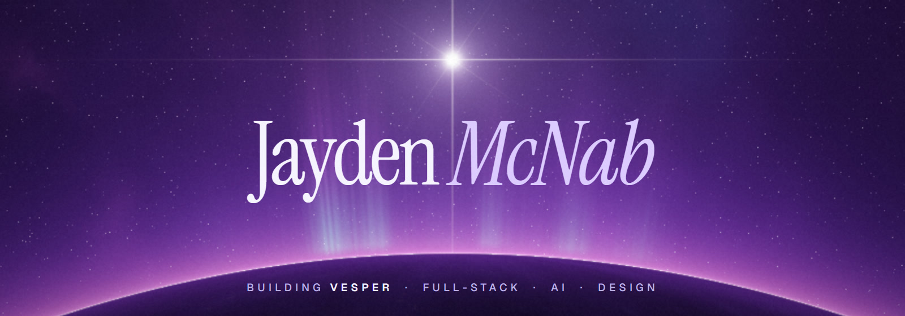</a>

  
  
  

  I build software that should feel calm to use: a web browser, a language app, data tools, 
  and the little films that show them off. TypeScript, React, Python and a lot of WebGL.

 

<h2 align="center">✦ &nbsp;Now building&nbsp; ✦</h2>

  <a href="https://youtu.be/VzxoIKm8kB4">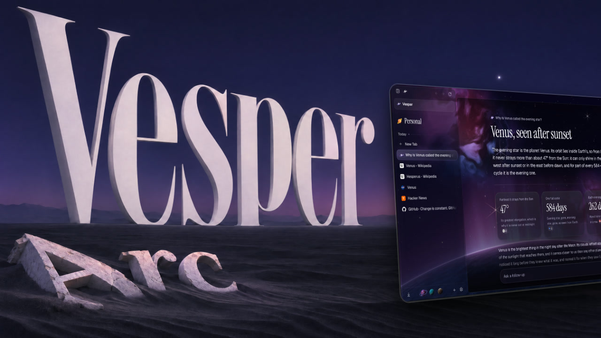</a>
   
  <a href="https://youtu.be/VzxoIKm8kB4">▶&nbsp; Watch the 34-second film</a>

  <b>Vesper</b> is a new web browser for Mac and Windows. 
  Tabs live in a sidebar, every space has its own sky, and when you ask it something 
  it answers with a page you can read, with its sources, instead of a wall of text.

  
  
   
  Free · macOS 12 or later on Apple silicon (<a href="https://browsevesper.com/download/mac-intel">Intel Mac here</a>) · Windows

 

  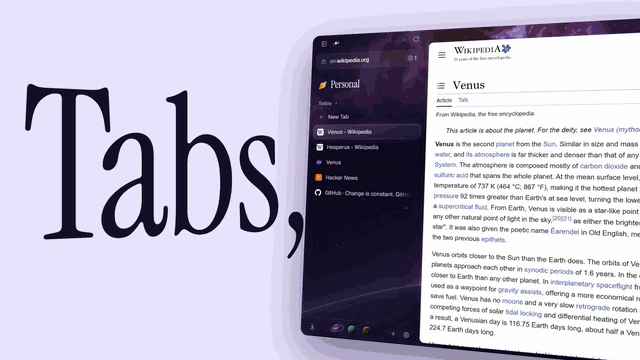

<table>
  <tr>
    <td width="50%" valign="top">
      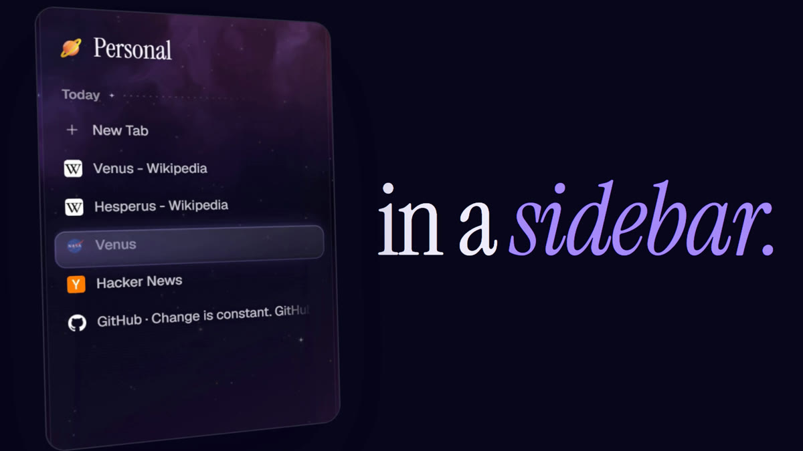
      <h3>Tabs in a sidebar</h3>
      Pinned tabs, folders and favourites that stay put. Today's tabs tidy themselves away when you're done with them.
    </td>
    <td width="50%" valign="top">
      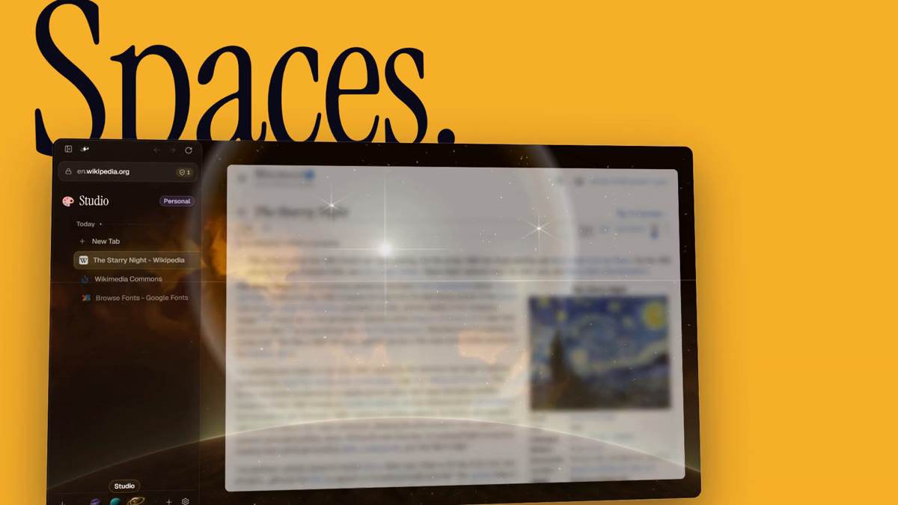
      <h3>Spaces, each with its own sky</h3>
      Work, home and every project in their own space, with their own logins, colours and planet.
    </td>
  </tr>
  <tr>
    <td width="50%" valign="top">
      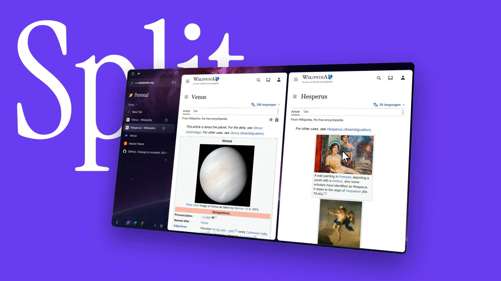
      <h3>Split view</h3>
      Drag a tab onto the page and you have two side by side, for reading while you write.
    </td>
    <td width="50%" valign="top">
      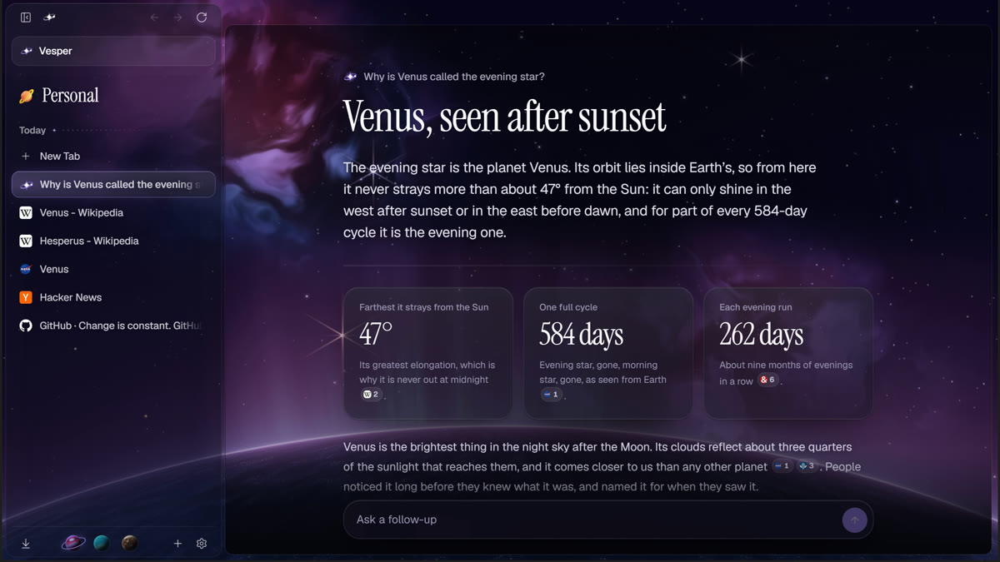
      <h3>Ask Vesper</h3>
      Ask anything and get an answer laid out as a page, with the sources it read. Or ask about the page you're on.
    </td>
  </tr>
</table>

  Also inside: a command bar, built-in ad and tracker blocking, a password manager, picture-in-picture, 
  end-to-end encrypted sync between your Mac and PC, and import from Arc.

  
  
  
  
  
  
  

 

<h2 align="center">✦ &nbsp;Also building&nbsp; ✦</h2>

  

  <b>LinguaFlow</b> teaches Polish with a bison calf called Lumi. 
  You walk a trail through Białowieża forest: answer flashcards, read real texts where every word 
  is one tap from its meaning, and play three short games for the parts of Polish that hurt.

  
  
   
  Version 1.0.71 · in private beta on TestFlight and Google Play · <a href="https://lingua-flow-web.vercel.app/">the original web translator is still live</a>

 

  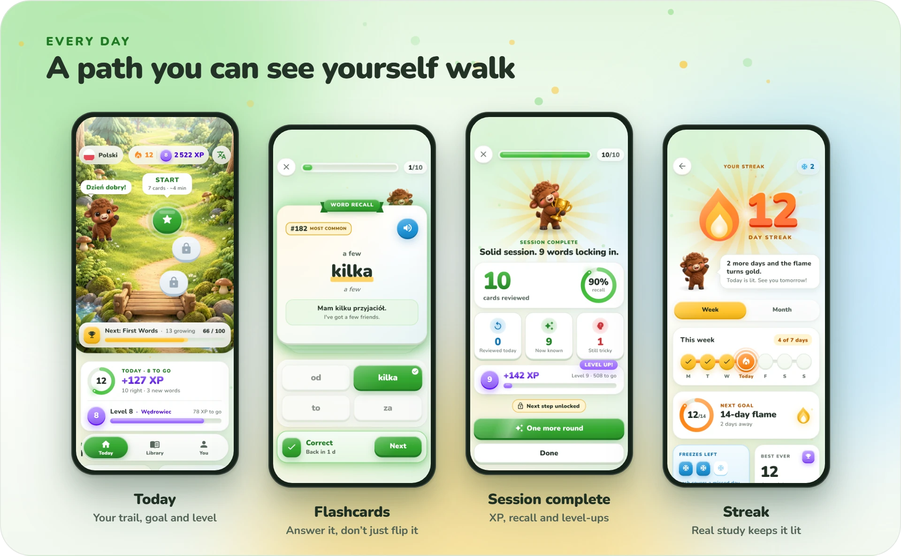

<table>
  <tr>
    <td width="33%" valign="top">
      <h3>Memory that lasts</h3>
      Spaced repetition on a word ledger keyed by dictionary form, so <i>kot</i>, <i>kota</i> and <i>kotem</i> are one word. A word only counts as known after it survives check-ups at 3, 30 and 120 days.
    </td>
    <td width="33%" valign="top">
      <h3>Reading first</h3>
      A paged reader with glosses on tap and a "% known" figure for every text. Stories are written at your level and rewritten if they come out too hard.
    </td>
    <td width="33%" valign="top">
      <h3>Progress every day</h3>
      XP and levels, a daily goal ring, and a milestone bar with a second layer for words still growing, so every session moves something you can see.
    </td>
  </tr>
</table>

  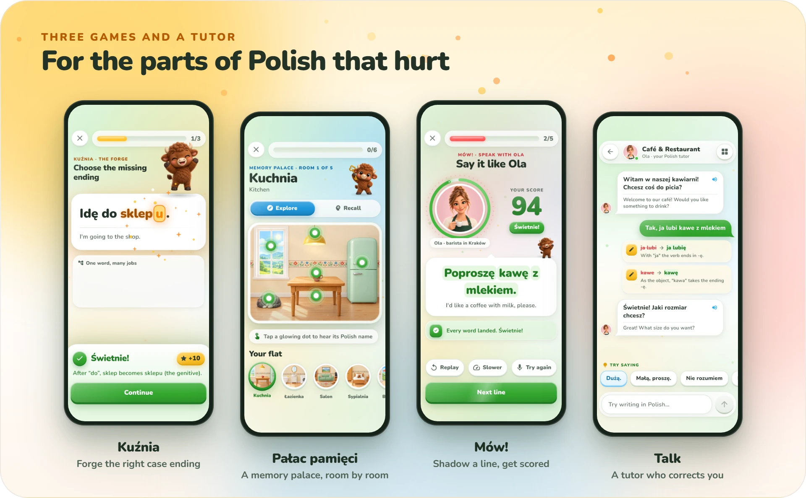

  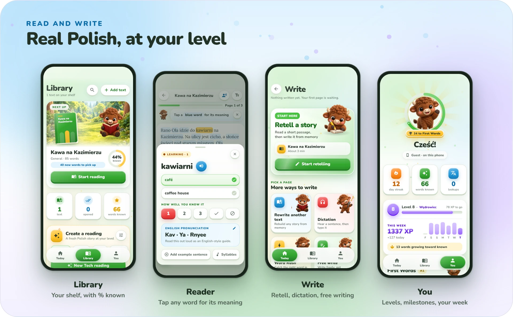

  <b>One app, three skins.</b> A skin swaps the colours, the scenery and Lumi's species; 
  the screens and the behaviour stay the same.

  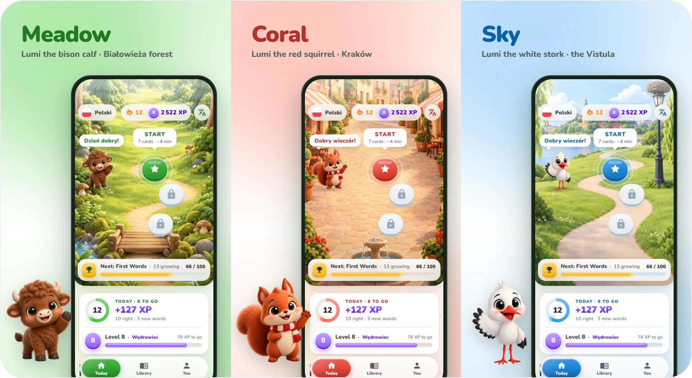

  Also inside: home-screen widgets with a new Polish word every hour, writing graded word by word, 
  pronunciation scoring, offline guest mode, sync between phones, and 1,044 automated tests behind it all.

  
  
  
  
  
  

 

<h2 align="center">✦ &nbsp;Other work&nbsp; ✦</h2>

<table>
  <tr>
    <td width="50%" valign="top">
      
      <h3>TNFD Tools Map</h3>
      An interactive map of how TNFD tools relate, with D3 force graphs, clustering by cosine similarity and natural-language search through Gemini.
        <a href="https://tnfd-clustering.netlify.app/"><b>Explore the map →</b></a>
    </td>
    <td width="50%" valign="top">
      
      <h3>G7 Global Conference</h3>
      A site for a private event venue in Warsaw: English and Polish, interactive floor plans for every layout, and a quiet marble-and-serif look.
        <a href="https://g7globalconference.com/"><b>Visit the site →</b></a>
    </td>
  </tr>
</table>

<h3 align="center">In the open</h3>

<table>
  <tr>
    <td valign="top"><a href="https://github.com/Jaystarter/custom-vector-search"><b>custom-vector-search</b></a> Semantic search with FastAPI and bge-micro, on a flat in-memory vector index with no vector database.</td>
    <td valign="top"><a href="https://github.com/Jaystarter/AI-Future-Game"><b>AI-Future-Game</b></a> A 2D exploration game in Vite and TypeScript that travels through four eras of AI.</td>
    <td valign="top"><a href="https://github.com/Jaystarter/after-query"><b>after-query</b></a> A Terminal-Bench task-creation guide and test framework on Docker and Python 3.12.</td>
  </tr>
</table>

 

<h3 align="center">Tools I reach for</h3>

  
  
  
  
  
  
  
  
  
  
  

 

  <a href="https://browsevesper.com"><i>Look up. It's out tonight.</i></a>

