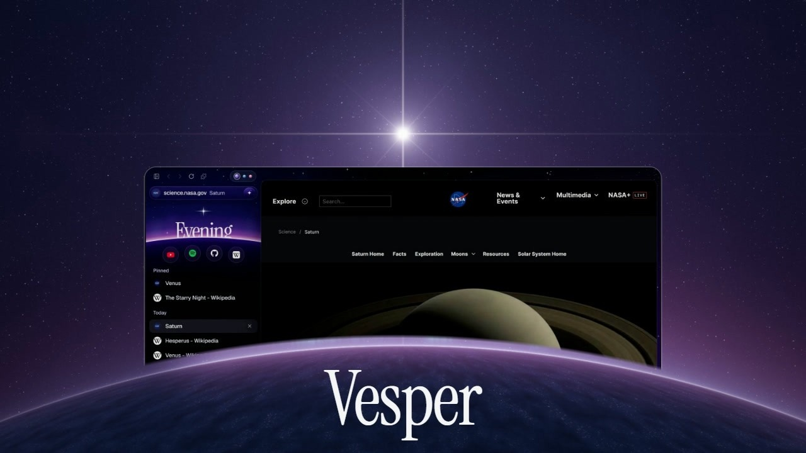
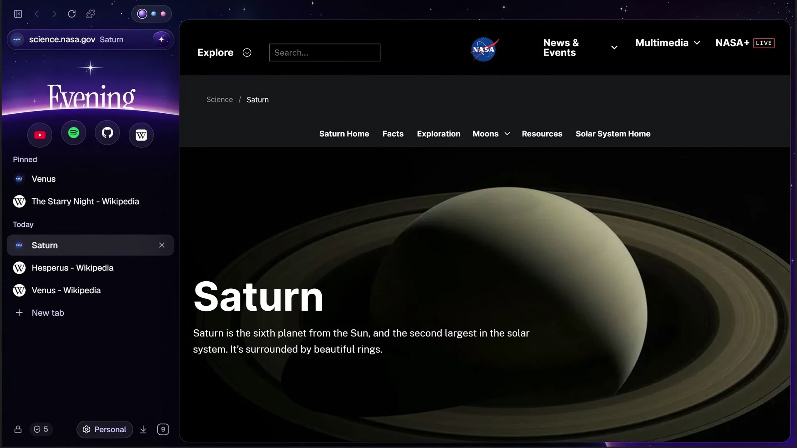
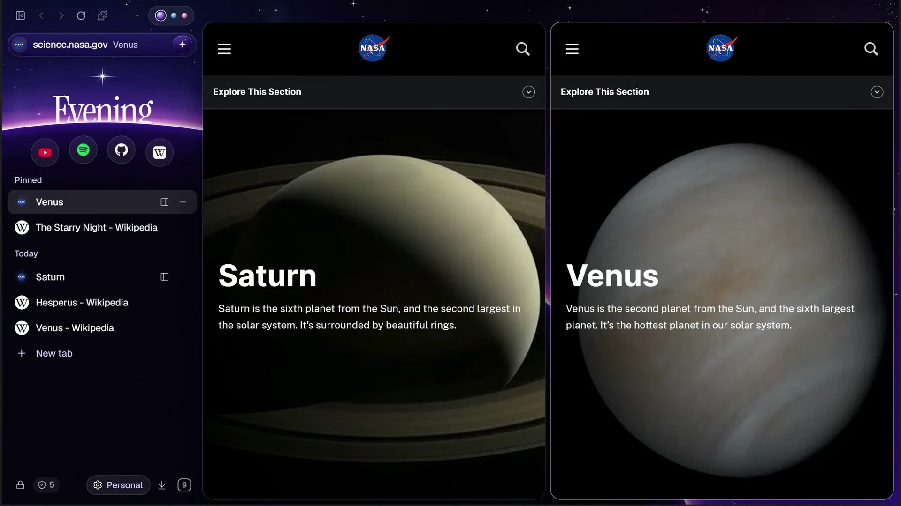
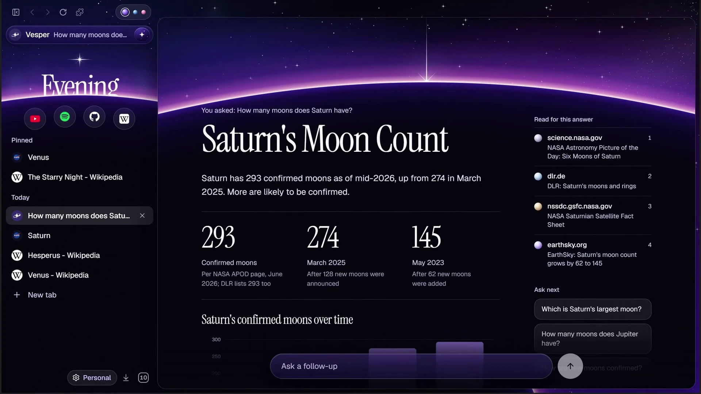

# Jayden McNab

I build browsers, language tools, and the short films that show how they work. Most days I’m writing TypeScript, Python, or Dart. Right now I’m building [Vesper](https://browsevesper.com).

[Watch my browser films](https://www.youtube.com/@browsevesper) · [Email me](mailto:jaydenmcnab02@gmail.com)

## Vesper

**[Watch the 46-second film](https://youtu.be/sC0MhCmYfFA)** · [Download for Mac or Windows](https://browsevesper.com/download)

<strong>Look inside the app</strong> — 3 Vesper screenshots

**Sidebar tabs.** Pinned sites stay above today’s tabs while you browse.

**Split view.** Compare NASA’s Saturn and Venus pages without switching tabs.

**Ask Vesper.** The answer to “How many moons does Saturn have?” has its sources alongside it.

In the film I open NASA’s pages for Saturn and Venus side by side, then ask how many moons Saturn has. Vesper lays out the answer as a page, with the sources alongside it. Choose Vesper’s AI, or use the Claude Code or Codex subscription already on your computer.

**What changed in 0.4.5:** While an answer is forming, you can follow each search and see which pages Vesper reads. Earlier steps fold away so the newest one stays in view.

**Inside the film:** [Sidebar tabs](https://youtu.be/sC0MhCmYfFA?t=7) · [Split view](https://youtu.be/sC0MhCmYfFA?t=15) · [Bring your own AI](https://youtu.be/sC0MhCmYfFA?t=21) · [The sourced answer](https://youtu.be/sC0MhCmYfFA?t=37)

Each space keeps its own logins, tabs, and sky. Chrome extensions install from the Chrome Web Store.

## LinguaFlow

In Polish, *kot*, *kota*, and *kotem* can all refer to the same cat. LinguaFlow lets you tap a word in a story and saves it under its dictionary form, so you practise one word instead of collecting three flashcards. Lumi, a bison calf, guides you along the forest trail.

[Try the original web translator](https://lingua-flow-web.vercel.app/)

Look inside the app

## Selected work

- **[TNFD Tools Map](https://tnfd-clustering.netlify.app/)** — Explore which nature-reporting tools are related through an interactive D3 map and natural-language search.
- **[G7 Global Conference](https://g7globalconference.com/)** — A bilingual site for a Warsaw event venue, with interactive floor plans for each room layout.
- **[custom-vector-search](https://github.com/Jaystarter/custom-vector-search)** — Semantic search with FastAPI and an in-memory index, without a vector database.
- **[AI Future Game](https://github.com/Jaystarter/AI-Future-Game)** — A playable tour through four eras of AI, built with Vite and TypeScript.
- **[after-query](https://github.com/Jaystarter/after-query)** — A guide and test framework for writing Terminal-Bench tasks in Docker and Python.
